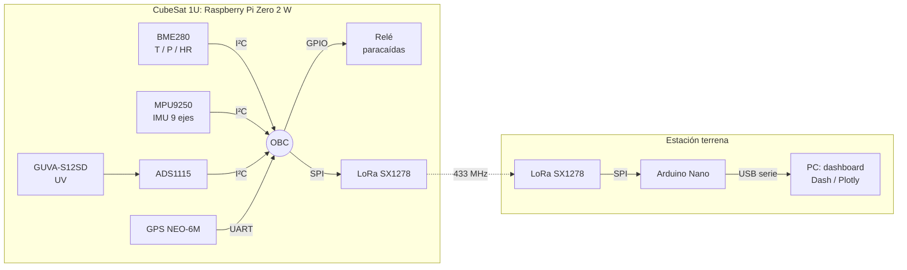

# TelEctroSat: CubeSat 1U


Prototipo de nanosatélite **CubeSat 1U** desarrollado por el equipo **TelEctroSat**, formado por estudiantes de la
Facultad de Ingeniería Eléctrica y Electrónica (FIEE) de la Universidad Nacional de Ingeniería (UNI), para la
**Competencia Nacional de Pequeños Satélites 2024**, organizada por la PUCP.

> 🏆 El equipo **ganó la fase preliminar** y fue **seleccionado para competir en la fase nacional** con este prototipo.

---

## Contenido

- [Misión](#misión)
- [Arquitectura del sistema](#arquitectura-del-sistema)
- [Hardware](#hardware)
- [Estructura del repositorio](#estructura-del-repositorio)
- [Puesta en marcha](#puesta-en-marcha)
- [Formato de telemetría](#formato-de-telemetría)
- [Pruebas de calificación](#pruebas-de-calificación)
- [Documentación](#documentación)
- [Equipo](#equipo)
- [Limitaciones conocidas](#limitaciones-conocidas)

---

## Misión

El objetivo es diseñar un nanosatélite de bajo costo que **monitoree parámetros ambientales de la troposfera**
(temperatura, presión, humedad y radiación ultravioleta) y transmita los datos en tiempo real a una estación terrena.

**Perfil de vuelo:**

1. Un dron eleva el CubeSat hasta **~100 m** de altura. Durante el ascenso se sincroniza el enlace LoRa con la
   estación terrena y se inicializan los sensores.
2. El CubeSat se desacopla del dron e inicia la caída libre.
3. Al detectar la altitud de despliegue, la computadora a bordo acciona un **relé** que libera el **paracaídas**.
4. Durante todo el descenso se transmite la telemetría, que se visualiza en una interfaz en tiempo real.
5. Tras el aterrizaje se comprueba que los sistemas sigan operativos y se muestra un resumen de la misión.

## Arquitectura del sistema



Hay más detalle (pines, direcciones I²C, parámetros de radio) en [`docs/arquitectura.md`](docs/arquitectura.md).

## Hardware

| Subsistema      | Componente                                   |
|-----------------|----------------------------------------------|
| Computadora (OBC) | Raspberry Pi Zero 2 W                      |
| Sensores        | BME280 (temperatura, presión, humedad)       |
|                 | MPU9250 (acelerómetro, giroscopio, magnetómetro) |
|                 | GPS NEO-6M                                   |
|                 | GUVA-S12SD (radiación UV) + ADC ADS1115      |
| Comunicaciones  | 2 × LoRa SX1278 (433 MHz), antena propia     |
| Estación terrena | Arduino Nano / ESP32 + SX1278               |
| Potencia (EPS)  | Baterías Ni-MH AA, reguladores LM2596 (3.3 V) y MT3608 (5 V), sensor de voltaje |
| Mecánica        | Estructura de nylon, paracaídas de nylon, actuador por relé/servomotor |

## Estructura del repositorio

```
CubeSat-1U---TelEctroSat/
├── software_vuelo/          # Código que corre en el CubeSat durante la misión
│   ├── main_vuelo.py        #   Programa principal: sensores → LoRa + paracaídas
│   ├── sensores/            #   Drivers de cada sensor/actuador (clases reutilizables)
│   └── versiones_anteriores/#   Iteraciones previas del transmisor (referencia)
├── estacion_terrena/        # Receptor LoRa (Arduino) y visualización de datos
├── pruebas/                 # Scripts de prueba unitaria de cada componente
│   ├── lora/  imu/  gps/  bme280/  uv_voltaje/  rele/  gpio/  dht11/
│   └── adquisicion_datos/   #   Registradores de datos a CSV
├── datos/                   # Registros de sensores capturados durante pruebas
├── cad/                     # Modelos AutoCAD de la estructura y del EPS
└── docs/
    ├── arquitectura.md      # Documentación técnica detallada
    ├── informes/            # Entregables oficiales de la competencia (PDF)
    └── competencia/         # Manual de la competencia
```

Cada carpeta principal tiene su propio `README.md`.

## Puesta en marcha

### 1. Preparar la Raspberry Pi

```bash
sudo raspi-config        # Interface Options → habilitar I2C, SPI y Serial Port (sin consola)
sudo apt install -y python3-pip python3-venv i2c-tools
i2cdetect -y 1           # Debe mostrar 0x68 (MPU9250), 0x76 (BME280) y 0x48 (ADS1115)
```

### 2. Instalar dependencias

```bash
git clone https://github.com/vsotoc666/CubeSat-1U---TelEctroSat.git
cd CubeSat-1U---TelEctroSat
python3 -m venv .venv && source .venv/bin/activate
pip install -r requirements.txt
```

### 3. Ejecutar el software de vuelo

```bash
cd software_vuelo
python3 main_vuelo.py
```

### 4. Estación terrena

Carga [`estacion_terrena/receptor_arduino_nano`](estacion_terrena/receptor_arduino_nano) en un Arduino Nano con un
módulo SX1278 y abre el monitor serie a 115200 baudios. Los pasos están en [`estacion_terrena/README.md`](estacion_terrena/README.md).

## Formato de telemetría

Cada paquete LoRa es una línea de texto CSV con 14 campos:

```
temperatura,presion,humedad,voltaje_uv,indice_uv,acc_x,acc_y,acc_z,gyro_x,gyro_y,gyro_z,latitud,longitud,altitud
```

| Campo                     | Unidad | Fuente      |
|---------------------------|--------|-------------|
| temperatura               | °C     | BME280      |
| presion                   | hPa    | BME280      |
| humedad                   | %      | BME280      |
| voltaje_uv                | V      | GUVA-S12SD  |
| indice_uv                 | 0–7    | GUVA-S12SD  |
| acc_x, acc_y, acc_z       | m/s²   | MPU9250     |
| gyro_x, gyro_y, gyro_z    | °/s    | MPU9250     |
| latitud, longitud         | grados decimales | GPS |
| altitud                   | m      | GPS         |

## Pruebas de calificación

Resumen del informe [`03_pruebas_vibracion_y_termicas.pdf`](docs/informes/03_pruebas_vibracion_y_termicas.pdf):

**Ciclado térmico:** con una secadora como fuente de calor y una fuente de frío, en fases de al menos 15 minutos.

| Sensor | Ubicación              | T. máx. | T. mín. | ¿Daño? |
|--------|------------------------|---------|---------|--------|
| T1     | Cara de referencia     | 43.3 °C | 8.0 °C  | No     |
| T2     | Raspberry Pi Zero 2 W  | 43.6 °C | 7.7 °C  | No     |

El CubeSat siguió transmitiendo con normalidad durante los cambios de fase. 🎥 [Video de la prueba](https://youtu.be/U8I1WXE-uy4)

**Vibración e impacto:**

| Prueba              | Aceleración máx. | ¿Daño? |
|---------------------|------------------|--------|
| Vibración aleatoria | 1.5 g (eje −Z)   | No     |
| Impacto             | 1.11 g (eje −Z)  | No     |

El centro de masa bajo (por las baterías en la base) permitió aterrizajes sin rebote.

## Documentación

| Documento | Descripción |
|-----------|-------------|
| [01 · Propuesta de misión](docs/informes/01_propuesta_de_mision.pdf) | Objetivos, descripción de la misión y estudio de factibilidad con comparativas de componentes |
| [02 · Diseño preliminar (PDR)](docs/informes/02_diseno_preliminar.pdf) | Cronograma, costos, subsistemas, mecánica, estación terrena y vehículo de lanzamiento |
| [03 · Pruebas de vibración y térmicas](docs/informes/03_pruebas_vibracion_y_termicas.pdf) | Pruebas de calificación caseras |
| [Manual de la competencia](docs/competencia/manual_competencia_nacional_pequenos_satelites.pdf) | Bases de la Competencia Nacional de Pequeños Satélites |
| [Arquitectura técnica](docs/arquitectura.md) | Conexiones, parámetros LoRa y flujo del software |

## Equipo

**TelEctroSat**: FIEE, Universidad Nacional de Ingeniería (Lima, Perú)

| Integrante                      | Rol                         |
|---------------------------------|-----------------------------|
| David Orlando Quispe Quiroz     | Líder / OBC                 |
| Victor Manuel Soto Cortez       | OBC, interfaz y comunicaciones |
| Andy Smith Reyna Santillan      | Telemetría y comunicaciones |
| Christian Raul Castillo Zelada  | Sistema eléctrico (EPS)     |
| Luis Enrique Lopez Cabanillas   | Sistema eléctrico           |
| Johann Daniel Rios Santiago     | Estructura mecánica         |
| Jhon Efrain Reyes Olortegui     | Paracaídas / mecánica       |

**Asesor:** Carlos Castillo Correa

## Limitaciones conocidas

Este es un prototipo de competencia y quedan puntos por mejorar:

- **Lógica del paracaídas:** `main_vuelo.py` acciona el relé cuando la altitud GPS es ≤ 100 m. Si el GPS no tiene
  fix, `sensor_gps.py` devuelve 95 m por defecto, lo que puede disparar el relé antes de tiempo. Conviene usar la
  altitud barométrica del BME280 y exigir que antes se haya superado la altura de liberación.
- **Configuración LoRa del receptor:** el sketch del Arduino usa los parámetros por defecto de la librería (BW 125 kHz,
  sync word 0x12), mientras que el CubeSat transmite con BW 250 kHz y sync word 0x34. Hay que igualarlos para que
  haya enlace (ver [`estacion_terrena/README.md`](estacion_terrena/README.md)).
- El dashboard de la estación terrena (`dashboard_telemetria.py`) quedó como borrador.
- Los scripts de `pruebas/` son pruebas exploratorias de cada componente y no forman parte del software de vuelo.

## Licencia

Distribuido bajo la licencia MIT. Ver [`LICENSE`](LICENSE).
Los informes en `docs/` pertenecen a sus autores y el manual de la competencia, a la organización (PUCP).
