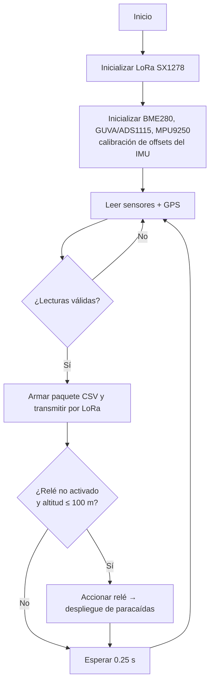

# Arquitectura técnica

## Computadora a bordo (OBC)

**Raspberry Pi Zero 2 W** con Raspberry Pi OS (Python 3.11). Corre `software_vuelo/main_vuelo.py`.

### Buses y conexiones

| Dispositivo        | Bus    | Dirección / puerto      | Notas |
|--------------------|--------|-------------------------|-------|
| BME280             | I²C-1  | `0x76`                  | `0x77` si SDO está a 3.3 V |
| MPU9250            | I²C-1  | `0x68`                  | `0x69` si AD0 está a 3.3 V. Magnetómetro AK8963 en `0x0C` (modo bypass) |
| ADS1115            | I²C-1  | `0x48` (por defecto)    | A0: GUVA-S12SD (UV) · A1: divisor de tensión de batería (×2) |
| GPS NEO-6M         | UART   | `/dev/ttyUSB0` @ 9600   | En pruebas también se usó `/dev/serial0` |
| LoRa SX1278        | SPI-0  | CE0 (GPIO 8), RST GPIO 22 | Pines por defecto de la librería LoRaRF |
| Relé (paracaídas)  | GPIO   | GPIO 20 (BCM) = pin físico 38 | Lógica activa en bajo |

### Parámetros de radio (LoRa)

| Parámetro         | Valor           |
|-------------------|-----------------|
| Frecuencia        | 433 MHz         |
| Potencia TX       | 18 dBm (PA_BOOST) |
| Spreading factor  | SF7             |
| Ancho de banda    | 250 kHz         |
| Coding rate       | 4/5             |
| Preámbulo         | 8 símbolos      |
| Cabecera          | Explícita       |
| CRC               | Habilitado      |
| Sync word         | `0x34`          |

El receptor de la estación terrena **debe usar los mismos valores** de SF, BW, CR y sync word.

## Flujo del software de vuelo

## Módulos de `software_vuelo/sensores`

| Módulo                   | Clase / función          | Devuelve |
|--------------------------|--------------------------|----------|
| `sensor_bme280.py`       | `BME280Sensor.leer_datos()` | `temperatura`, `presion`, `humedad` |
| `sensor_uv_guva.py`      | `GUVA_Sensor.leer_datos()`  | `voltaje`, `indice_uv` (escala 0–7) |
| `sensor_imu_mpu9250.py`  | `MPU9250Sensor.leer_datos()`| aceleración (m/s²) y velocidad angular (°/s) en 3 ejes, con offset calibrado al arrancar |
| `sensor_gps.py`          | `leer_datos_gps(timeout)`   | `(lat, lon, alt)` a partir de tramas `$GPGGA`. Si no hay fix, `(0, 0, 95)` |
| `actuador_rele.py`       | `RelayController`           | Pulso de 2 s en el relé del paracaídas |

## Estación terrena

- **Receptor:** Arduino Nano + SX1278 (SS = D10, RST = D9, DIO0 = D2) con la librería
  [arduino-LoRa](https://github.com/sandeepmistry/arduino-LoRa). Reenvía cada paquete por el puerto serie (115200 baudios).
- **Visualización:** prototipos en Python con Dash/Plotly (gráficas en tiempo real) y PyGame/OpenGL (orientación 3D),
  además de un cliente MQTT de prueba.

## Subsistema de potencia (EPS)

Baterías Ni-MH AA de 1.2 V y 2500 mAh, regulador reductor LM2596 (3.3 V) y elevador MT3608 (5 V). El voltaje de la
batería se mide con el ADS1115 mediante un divisor resistivo. El diseño del EPS está en `cad/eps_diseno_v1.dwg`.
